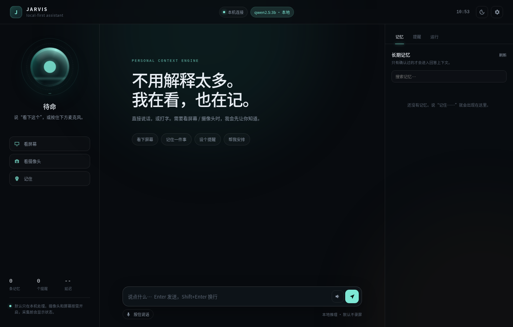

# Jarvis v2 — 重新设计基线



- Status: **v2 baseline accepted; a working vertical slice is implemented under `v2/`**
- Branch: `feat/jarvis-v2`
- Date: 2026-10-26
- Supersedes for v2: [`docs/plan/architecture.md`](../plan/architecture.md) (retained as v1 history)

## 为什么重做

v1 是一个以文字为主的 macOS MVP：它证明了 Harness 集成、审批、设备身份、备份恢复这些工程能力，但产品形态不对。

v2 不再从“给 agent 加一个聊天窗口”出发，而是从下面这个画面出发：

> 一个常驻的私人助手。它平时安静，知道什么时候该听、该看屏幕、该看摄像头、该不该开口；能实时对话，能记住重要的事，也能替你动手。

这不是“更强的 coding agent”，也不是“带摄像头的聊天框”。它首先是一个**注意力系统**，其次才是一个对话系统。

## 一句话定义

**Jarvis 是一个本地优先、有感官、有记忆、能动手、知道何时不打扰的私人助手。**

四个关键词：

1. **有感官**：麦克风、屏幕、按需摄像头；不是持续录像。
2. **有记忆**：分层、可解释、可遗忘、可纠正；不是聊天记录堆。
3. **能动手**：文件、浏览器、日历、提醒、设备；高风险动作需确认。
4. **知道何时不打扰**：主动但不烦人；沉默是默认，开口是决策。

## 设计文档

| 文档 | 内容 | 状态 |
|---|---|---|
| [jarvis-design.md](jarvis-design.md) | 产品形态、注意力管理器、实时语音、感官、架构、客户端、里程碑 | Baseline |
| [memory-design.md](memory-design.md) | 记忆类型、写入、检索、巩固、遗忘、隐私、评测、迁移 | Baseline |
| [decision-register.md](decision-register.md) | 已固定的决策、理由、影响 | Accepted |
| [implementation-plan.md](implementation-plan.md) | v2 的实现切片与验收顺序 | Draft；已按纵向切片推进 |
| [implementation-status.md](implementation-status.md) | 已实现 / 部分实现 / 缺口 / 验证方式 | Implemented baseline |
| [operations.md](operations.md) | 安装、启动、远程、隐私、验收、故障排查 | Implemented baseline |

## v2 范围

**做：**

- Linux 桌面优先；单用户、单核心宿主。
- 实时语音对话：按住说话起步，唤醒词后置；支持打断和追问。
- 按需屏幕上下文：当前窗口、选区、截图、OCR/视觉理解。
- 按需摄像头上下文：单帧或短 burst，本地先做检测。
- 注意力管理器：决定何时看、看哪一路、何时说、用什么通道说。
- 记忆 v2：分层存储、时间有效性、混合召回、离线巩固、可解释召回。
- 本地/远端模型路由：本地能做的本地做，复杂的按策略上云。
- 工具执行：文件、浏览器、日历、提醒；高风险动作走审批和审计。
- 桌面浮窗/托盘 + 手机 PWA/WebRTC 远程入口（手机后置）。

**不做：**

- 数字人、实时 lip-sync 虚拟形象。
- 7×24 摄像头/麦克风录制。
- 多用户、家庭成员识别。
- 自主付款、开门、删除大批文件等高风险动作。
- 重写 Linux 桌面或办公套件。
- 默认把屏幕/摄像头内容上传云端。

## 与 v1 的关系

- v1 代码保留在 `main`，作为实现参考和历史证据。
- v2 **不整体复用** v1 运行时；只复用经过评审的局部能力（审批、审计、设备身份、恢复）。
- v1 的 `memory.json` 可以导入为 v2 的 `profile` / `episodic` 记忆，来源标记为 `v1-import`，状态为 `confirmed`，但必须保留原 id 和时间。
- v2 的第一行代码从 `docs/v2` 的验收切片开始，不从“再加一个功能”开始。

## 平台决策

- **开发与第一验收主机：Linux 桌面**（当前 Ubuntu 环境）。
- **macOS：后续平台**，不是 v2 的第一出口；v1 的 macOS 代码不阻塞 v2。
- **手机：远程客户端**，通过 Gateway/WebRTC 接入；不在手机本地跑核心。
- **模型**：DeepSeek Harness 作为可选运行时/模型适配之一，放在 adapter 后面；v2 核心不直接依赖某个模型供应商。

## 文档修改规则

1. 本目录是 v2 的唯一设计基线；代码行为与文档冲突时，先改文档或先补 decision，不允许“代码里悄悄改”。
2. 任何影响产品边界、隐私、记忆权威、平台选择的改动，必须新增或修改 [decision-register.md](decision-register.md)。
3. 未决问题明确标为 `Open`，不要用模糊措辞伪装成已决定。
4. 实现完成后，把对应条目的 `Status` 从 `Draft` 改为 `Implemented`，并附验证链接。

## 下一步

当前 `v2/` 已跑通“文字/语音 → 注意力 → 记忆 → 回答 → TTS”和“按需屏幕 OCR → 回答”：

```bash
cd v2
npm run setup   # 用户目录安装模型/依赖
npm start       # http://127.0.0.1:3081
npm test
npm run doctor
```

下一步按 [implementation-status.md](implementation-status.md) §4 的收益排序推进：真实 Portal 验收、手机 PWA 真机、记忆评测、工具执行。